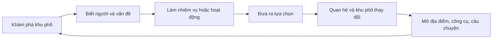

# Định hướng gameplay dài hạn — Phố Phú Thượng

## Cập nhật 29/10/2026

Đã triển khai **Tấm ảnh trước cửa** vào bảng N: nhận ảnh tại hiệu sách bác Sơn, hỏi cô Liên/chú Bình theo thứ tự tùy chọn, lưu manh mối, suy luận có phản hồi sai/đúng, xin ý kiến gia đình, chọn ba cách khép lại và thay bảng lời kết trong Ngõ 41. Có tạm gác/tiếp tục, không giới hạn thời gian; tiến độ giữ qua ngày và tải lại. Chi tiết, giới hạn và kiểm thử trong [PHOTO_MYSTERY_DESIGN.md](./PHOTO_MYSTERY_DESIGN.md). Các phần dưới ghi chương này “đề xuất/chưa làm” là trạng thái trước cập nhật này.

## Cập nhật 28/10/2026

Đã nối tuyến chuyện nhỏ **Giữ một góc ngõ** vào bảng N: giúp ba nhóm cư dân khác nhau qua các công việc, chọn Góc xanh hoặc Góc ảnh, nhận một cấp công trình thật trong Ngõ 41 và lời kết tương ứng. Tiến độ giữ qua ngày, save/reload và chống nhận kết thúc lặp. Không phát sinh sự kiện khẩn cấp mới khi đang làm một công việc ngày. Đây là tuyến dẫn tiến triển ban ngày; chưa phải chiến dịch có điều tra và hội thoại phân nhánh ngoài phố.

Định hướng đồ họa, thế giới sống và chương điều tra tiếp theo: [WORLD_EXPERIENCE_PLAN.md](./WORLD_EXPERIENCE_PLAN.md). Các phần chưa triển khai được đánh dấu rõ trong tài liệu đó.

## Chế độ thường đã bổ sung — 27/10/2026

Mở **Việc hôm nay (N)** để chọn một trong ba ca. Đây là nội dung đã nối vào bản chạy, tách khỏi chương kinh dị:

- **Giao xôi:** tới gánh trước cổng trường, chốt ba nhịp đong/gói; chất lượng phụ thuộc nhịp. Giao hai điểm theo thứ tự tự chọn. Sau khi gói có 110 giây thưởng nóng; trễ vẫn được tiền gốc. Ôm cua gắt khi chạy xe làm giảm chất lượng hàng. Tuyến cổng trường/quán trà và ngã ba/chợ hoa luân phiên theo ngày.
- **Dọn ngõ:** ba điểm rác có vật thể và dấu chỉ trong cảnh, nhặt theo thứ tự tùy ý, vật thể biến mất ngay. Gom đủ rồi về quán trà phân loại chai nhựa/lá/khăn giấy. Chọn nhầm được sửa nhưng giảm chất lượng.
- **Bộ ảnh cư dân:** tìm hai địa điểm theo lời nhắn, đứng trong 6 m và nhìn đúng hướng rồi bấm P. Sau đó về quán trà chọn thứ tự bộ ảnh theo lời nhắn. Ngày lẻ là cổng trường/cổng làng, ngày chẵn là chợ hoa/công viên. Không dùng ảnh check-in cũ để hoàn thành ca mới.
- **Lựa chọn thưởng:** nhận đủ tiền và một điểm đóng góp, hoặc nhận nửa tiền và hai điểm. Điểm dùng xây Góc xanh/Góc ảnh trong Ngõ 41, mỗi nhánh ba cấp, chi phí lần lượt 2/3/4 điểm. Thay đổi hiện trong cảnh và giữ qua ngày mới.
- **Tiến triển:** mỗi ca chỉ trả thưởng một lần trong ngày; ngày mới đổi đề bài, làm mới các ca, giữ tiền/XP/điểm/công trình và tổng việc đã làm. Công việc đang làm, các điểm đã xong, chất lượng và thời gian còn lại được lưu. Đồng hồ giao hàng dừng khi đọc bảng/đối thoại, vào chương kinh dị hoặc tab không hoạt động.
- **Ảnh thật:** chụp từ khung 3D, thu nhỏ 256×144 JPEG; giữ tối đa hai ảnh trong save và dùng làm ảnh treo trên công trình Góc ảnh. Không lưu ảnh toàn màn hình hoặc ảnh HUD.

Kiểm tra bản này: `npm test` 37/37 đạt. `tests/daylife-preview.html` chạy ca dọn ngõ, phân loại sai/đúng, lựa chọn quỹ, xây công trình và tải lại; `?mode=delivery` thử ba nhịp gói và đồng hồ dừng/tiếp tục; `?mode=photo` thử chụp đúng hướng, JPEG hiển thị lại và chống lặp tiến độ. Ba phiên kiểm thử trình duyệt đều đạt, không ghi nhận lỗi console. Chưa chạy tự động toàn bộ hai tuyến giao hàng và cả hai bộ ảnh từ đầu tới cuối; thứ tự điểm giao, điều kiện nhận thưởng, ngày mới và lưu tiến độ được kiểm tra bằng unit test.

Phạm vi hiện tại là ba kiểu hoạt động với hai bộ tuyến luân phiên và lời nhắn ba ngày; chưa phải hệ thống cốt truyện vô hạn hoặc lịch sinh hoạt đầy đủ của NPC. Các phần định hướng bên dưới chưa mặc định đã triển khai.

> Cập nhật hướng chính: bản đêm kinh dị điều tra và trạng thái đã làm được ghi trong [NIGHT_41_DESIGN.md](./NIGHT_41_DESIGN.md). Phần dưới là định hướng khu phố ban ngày trước đây; các chương tương lai được ghi rõ trong tài liệu mới, không mặc định là nội dung đã chơi được.

## Trạng thái vertical slice

Đã triển khai trong bản hiện tại:

- Autosave có version và tiếp tục đúng vị trí, thời gian, tiền, XP, túi đồ, nhiệm vụ, ảnh và di sản.
- Chu kỳ ngày–giờ chạy trong thời gian thực và màn hình tổng kết / bắt đầu ngày mới.
- Quan hệ riêng với NPC cùng bốn chỉ số Gắn kết, Sạch đẹp, Sinh kế và Di sản.
- Trò gói Xôi Phú Thượng ba bước, có thời gian và chất lượng thành phẩm.
- Hai nhánh nâng cấp quán cô Hoa: góc xanh hoặc bảng kể chuyện di sản.
- Thay đổi cảnh quan 3D theo lựa chọn của người chơi.

## 1. Định vị đề xuất

**Thể loại:** nhập vai đời sống khu phố kết hợp khám phá văn hóa và quản lý cộng đồng nhẹ.

**Vai trò người chơi:** một cư dân trẻ trở về Phú Thượng. Người chơi làm quen với hàng xóm, giải quyết việc trong khu phố, gìn giữ di sản và dần trở thành người có ảnh hưởng trong cộng đồng.

**Lời hứa trải nghiệm:** mọi việc người chơi làm đều khiến con người, địa điểm hoặc hoạt động trong khu phố thay đổi theo cách có thể nhìn thấy.

Hướng này tận dụng đúng những gì game đã có: bản đồ Phú Thượng, NPC địa phương, tiền, XP, túi đồ, xe máy, ảnh check-in, di sản và chuỗi nhiệm vụ. Nó cũng cho phép thêm nội dung từng phần mà không phải xây lại toàn bộ game.

## 2. Vòng lặp chơi cốt lõi

Một phiên chơi nên kéo dài khoảng 15–25 phút:

1. **Nhận tin trong ngày** từ bảng tin hoặc điện thoại: 3–5 việc đang xảy ra trong khu phố.
2. **Chọn lịch trình** dựa trên thời gian, quan hệ, vật phẩm và phương tiện hiện có.
3. **Di chuyển và quan sát** để tìm NPC, dấu vết, nguyên liệu hoặc địa điểm.
4. **Thực hiện hoạt động**: đối thoại, giao hàng, chụp ảnh, trò chơi ngắn, giải đố hoặc xử lý tình huống.
5. **Đưa ra lựa chọn** ảnh hưởng đến một NPC, một nhóm dân cư hoặc chỉ số khu phố.
6. **Nhận kết quả**: tiền, vật phẩm, quan hệ, kỹ năng, thay đổi cảnh quan hoặc mở khóa câu chuyện.
7. **Kết thúc ngày** tại nhà hoặc một địa điểm an toàn, xem khu phố đã thay đổi và chuẩn bị ngày tiếp theo.

Vòng lặp dài hạn:



## 3. Bốn trụ cột gameplay

### 3.1. Quan hệ với cư dân

Mỗi NPC quan trọng có:

- Mức thân thiết từ 0–5.
- Lịch sinh hoạt theo buổi sáng, trưa, chiều, tối.
- Sở thích, vấn đề và mối quan hệ với NPC khác.
- Một chuỗi câu chuyện riêng gồm 3–5 bước.
- Phản ứng khác nhau theo việc người chơi từng làm.

Ví dụ: giúp cô Hoa tìm nguồn trà tốt sẽ làm quán đông khách hơn. Nếu ưu tiên giao hàng cho trường học, cô Hoa vẫn nhớ việc đó và nhờ người chơi vào một ngày khác.

### 3.2. Khu phố có trạng thái

Thêm bốn chỉ số chung, mỗi chỉ số từ 0–100:

| Chỉ số | Người chơi tác động bằng cách nào | Thay đổi nhìn thấy được |
|---|---|---|
| Gắn kết | Giúp dân, hòa giải, tổ chức sự kiện | NPC tụ tập, chào hỏi, mở hội |
| Sạch đẹp | Dọn rác, trồng cây, sửa điểm xuống cấp | Ít rác, thêm cây, biển hiệu đẹp hơn |
| Sinh kế | Mua bán, hỗ trợ hàng quán, kết nối khách | Quán đông hơn, thêm hàng hóa và NPC |
| Di sản | Thu thập tư liệu, phục dựng, dẫn tour | Địa điểm được tu sửa, mở câu chuyện lịch sử |

Các chỉ số này tạo kết quả chung cho nhiều nhiệm vụ. Người chơi nhìn thấy khu phố phát triển thay vì chỉ nhìn con số XP tăng.

### 3.3. Hoạt động có kỹ năng

Nhiệm vụ nên chứa một hành động chơi được, không chỉ đi đến điểm và bấm E:

- Gói xôi theo đúng đơn trong giới hạn thời gian.
- Pha trà theo khẩu vị khách.
- Chụp đúng bố cục hoặc đúng thời điểm trong ngày.
- Sắp xếp hồ sơ tại UBND theo thông tin và thứ tự.
- Điều khiển xe máy giao hàng nhưng phải giữ hàng nguyên vẹn.
- Quét lá, phân loại rác hoặc trồng cây bằng thao tác ngắn.
- Ghép ảnh cũ với địa điểm hiện tại để tìm dấu tích.
- Dẫn tour bằng cách chọn thông tin đúng cho từng nhóm khách.

Mỗi trò chơi ngắn chỉ cần 30–90 giây, có điểm số và cấp độ khó tăng dần.

### 3.4. Lựa chọn và hậu quả

Mỗi chương nên có ít nhất một lựa chọn khiến nội dung sau đó thay đổi.

Ví dụ một khu đất trống có ba hướng phát triển:

- Làm sân chơi: tăng Gắn kết, mở hoạt động trẻ em.
- Làm chợ phiên: tăng Sinh kế, mở người bán và vật phẩm.
- Làm vườn cộng đồng: tăng Sạch đẹp, mở nguyên liệu và nhiệm vụ cây xanh.

Không cần tạo ba bản đồ khác nhau. Có thể thay cụm vật thể, NPC xuất hiện, lời thoại và hoạt động tại cùng một vị trí.

## 4. Tiến trình người chơi

### Cấp bậc

| Cấp | Danh hiệu | Mở khóa |
|---|---|---|
| 1 | Cư dân mới | Đi bộ, trò chuyện, mua bán cơ bản |
| 2 | Người quen trong phố | Điện thoại, việc hàng ngày, sửa xe |
| 3 | Người kết nối | Tổ chức nhóm, dẫn tour, nhận việc lớn |
| 4 | Đại sứ khu phố | Quyết định dự án cộng đồng, mở lễ hội |
| 5 | Người gìn giữ Phú Thượng | Chương cuối và New Game Plus |

### Ba nhánh kỹ năng

- **Giao tiếp:** thêm lựa chọn đối thoại, nhận giá tốt, hòa giải hiệu quả.
- **Khám phá:** đánh dấu manh mối, chụp ảnh tốt hơn, tìm đồ hiếm.
- **Khéo léo:** làm trò chơi ngắn dễ hơn, sửa chữa và chế tạo vật phẩm.

Người chơi có thể hoàn thành cốt truyện với mọi cách phân điểm, nhưng cách giải quyết nhiệm vụ sẽ khác nhau.

### Kinh tế

Giữ hai tài nguyên chính:

- **Tiền:** mua đồ ăn, nhiên liệu, trang phục, đồ trang trí và nâng cấp công cụ.
- **Uy tín cộng đồng:** mở nhiệm vụ, địa điểm, sự kiện và lựa chọn quan trọng.

XP chỉ dùng để tăng cấp. Vật phẩm nhiệm vụ cần có công dụng rõ hoặc được bỏ sau khi nhiệm vụ kết thúc để túi đồ không đầy vật vô nghĩa.

## 5. Cấu trúc chiến dịch đề xuất

### Chương 1 — Người mới về phố

- Học di chuyển, mua xôi, gặp bảo vệ và cán bộ phường.
- Mở điện thoại, bản đồ và túi đồ.
- Kết thúc bằng một buổi họp dân nhỏ.

### Chương 2 — Chuyện của từng nhà

- Mở chuỗi quan hệ với cô Hoa, học sinh, tổ trưởng và cựu chiến binh.
- Giới thiệu lịch sinh hoạt, thời tiết và nhiệm vụ có thời hạn.
- Người chơi chọn dự án đầu tiên cho khu phố.

### Chương 3 — Ký ức Phú Thượng

- Điều tra ảnh cũ, câu chuyện truyền miệng và địa điểm lịch sử.
- Có nhiệm vụ cần phỏng vấn nhiều người để đối chiếu thông tin.
- Mở hệ thống dẫn tour và bộ sưu tập ký ức.

### Chương 4 — Phố thay đổi

- Xung đột giữa sinh kế, giao thông, cảnh quan và bảo tồn.
- Các lựa chọn trước đây thay đổi NPC tham gia và nguồn lực có sẵn.
- Người chơi thực hiện một dự án cộng đồng lớn.

### Chương 5 — Lễ hội Phú Thượng

- Chuẩn bị gian hàng, tuyến tham quan, biểu diễn và an ninh.
- Kết quả lễ hội dựa trên quan hệ, chỉ số khu phố và các nhiệm vụ đã hoàn thành.
- Nhiều đoạn kết, sau đó vẫn có thể tiếp tục chơi tự do.

## 6. Ba kịch bản phát triển sản phẩm

### Kịch bản A — Bản trải nghiệm văn hóa

**Thời gian:** 4–8 tuần.

**Phạm vi:** 60–90 phút chơi, một ngày trong game, 5 NPC chính, 3 trò chơi ngắn, một kết thúc.

**Phù hợp khi:** cần demo cho trường học, địa phương, nhà tài trợ hoặc triển lãm.

**Rủi ro:** ít khả năng chơi lại nếu không có điểm số, thử thách hoặc nhiều kết quả.

### Kịch bản B — Game nhập vai khu phố độc lập

**Thời gian:** 4–8 tháng cho bản đầu đủ nội dung.

**Phạm vi:** 7–14 ngày trong game, 12 NPC có quan hệ, 20–30 nhiệm vụ, 6 trò chơi ngắn, 3 dự án cộng đồng và nhiều kết thúc.

**Phù hợp khi:** muốn tạo sản phẩm có bản sắc, có thể phát hành và tiếp tục mở rộng từng khu vực.

**Đây là hướng đề xuất.** Nó đủ sâu để giữ người chơi nhưng vẫn dùng được bản đồ và hệ thống hiện tại.

### Kịch bản C — Thành phố sống trực tuyến

**Thời gian:** 12–24 tháng trở lên.

**Phạm vi:** nhiều khu vực, nội dung theo mùa, tài khoản, đồng bộ dữ liệu, sự kiện cộng đồng và có thể có co-op.

**Phù hợp khi:** đã chứng minh được vòng lặp của kịch bản B và có đội vận hành nội dung.

**Rủi ro:** máy chủ, moderation, đồng bộ trạng thái và sản xuất nội dung liên tục làm chi phí tăng mạnh.

## 7. Kiến trúc cần xây trước khi thêm nhiều nội dung

Tệp `app.js` hiện chứa cả dựng cảnh, NPC, nhiệm vụ, kinh tế và vòng lặp game. Trước khi mở rộng, nên tách thành các hệ thống:

- `game-state.js`: tiền, XP, kỹ năng, quan hệ, thời gian và trạng thái khu phố.
- `save-system.js`: lưu phiên bản dữ liệu vào localStorage, autosave và migration.
- `quest-system.js`: nhiệm vụ dạng dữ liệu với điều kiện, bước, nhánh và phần thưởng.
- `dialogue-system.js`: lời thoại có điều kiện và ghi nhớ lựa chọn.
- `npc-system.js`: lịch trình, hành vi, quan hệ và animation.
- `activity-system.js`: giao diện chung cho các trò chơi ngắn.
- `world-state.js`: bật/tắt vật thể, thay cảnh và sinh NPC theo kết quả.
- `content/`: dữ liệu NPC, nhiệm vụ, vật phẩm, hội thoại và địa điểm.

Mỗi nhiệm vụ cần mô tả bằng dữ liệu thay vì viết riêng nhiều nhánh `if`:

```js
{
  id: 'hoa_tea_supplier',
  prerequisites: ['meet_hoa'],
  steps: [
    { type: 'talk', target: 'hoa' },
    { type: 'collect', item: 'tea_sample', count: 3 },
    { type: 'activity', activity: 'tea_tasting' },
    { type: 'choice', choices: ['quality', 'cheap', 'local'] }
  ],
  rewards: { coins: 20000, trust: { hoa: 1 }, neighborhood: { livelihood: 4 } }
}
```

## 8. Vertical slice nên làm ngay

Xây một ngày chơi hoàn chỉnh thay vì dàn trải thêm nhiều NPC:

1. Autosave và nút tiếp tục.
2. Đồng hồ sáng–trưa–chiều–tối có NPC đổi vị trí.
3. Quan hệ với ba NPC: bảo vệ, cô Hoa, cán bộ phường.
4. Một chuỗi nhiệm vụ có hai cách giải quyết.
5. Hai trò chơi ngắn: gói xôi và chụp ảnh.
6. Một thay đổi trực quan ở quán cô Hoa sau khi hoàn thành.
7. Màn hình kết ngày cho biết lựa chọn và tác động.

Vertical slice này kiểm chứng được phần quan trọng nhất: người chơi có thấy mình đang sống trong khu phố và có muốn bắt đầu ngày tiếp theo hay không.

## 9. Thứ tự triển khai

### Mốc 1 — Nền tảng tiến trình

- Save/load có version.
- Quest state machine dạng dữ liệu.
- Quan hệ NPC và uy tín cộng đồng.
- Đồng hồ ngày và lịch NPC.

### Mốc 2 — Một ngày chơi hoàn chỉnh

- Chuỗi nhiệm vụ phân nhánh.
- Hai trò chơi ngắn.
- Thay đổi cảnh quan theo kết quả.
- Tổng kết cuối ngày.

### Mốc 3 — Chiến dịch ngắn

- 3 ngày trong game.
- 6 NPC có chuỗi quan hệ.
- Dự án cộng đồng đầu tiên.
- Cân bằng kinh tế và tiến trình.

### Mốc 4 — Sản phẩm dài hạn

- 7–14 ngày nội dung.
- Chương di sản và lễ hội.
- Nhiều kết thúc.
- Công cụ nội bộ để thêm nhiệm vụ mà không sửa logic lõi.

## 10. Tiêu chí đánh giá gameplay

- Người chơi hiểu mục tiêu đầu tiên trong dưới 60 giây.
- Mỗi 3–5 phút có một quyết định, khám phá hoặc hoạt động mới.
- Nhiệm vụ quan trọng luôn tạo ít nhất một thay đổi nhìn thấy được.
- Một ngày chơi có mở đầu, cao trào và kết quả rõ ràng.
- Người chơi có ít nhất hai lý do để quay lại ngày tiếp theo.
- Sau 30 phút, người chơi nhớ tên hoặc vai trò của ít nhất ba NPC.
- Nội dung mới được thêm bằng dữ liệu, không làm `app.js` tiếp tục phình lớn.
